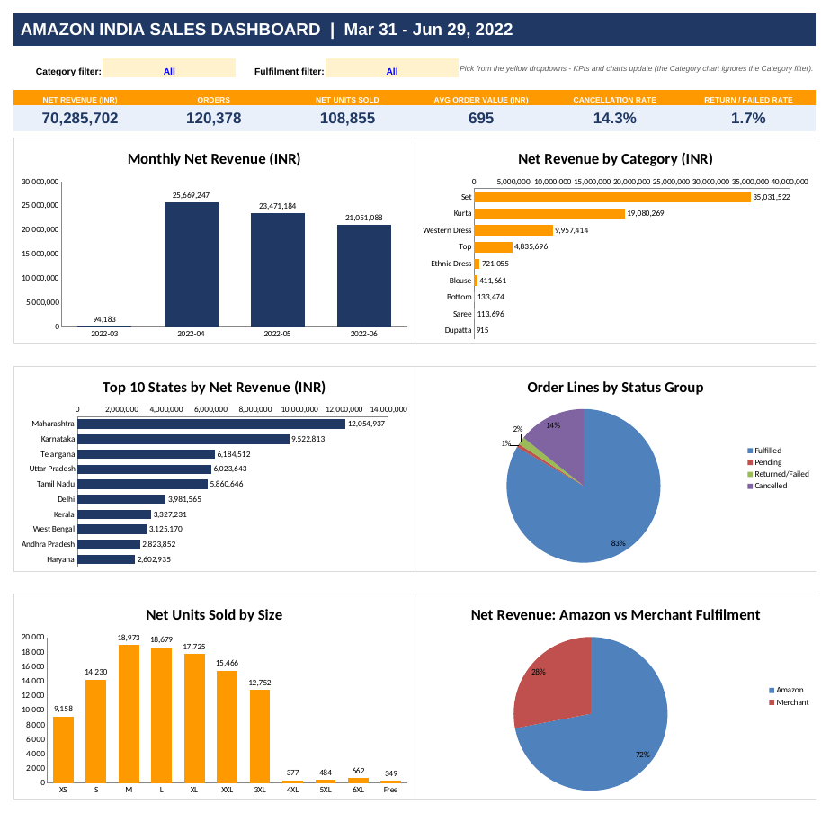

# Amazon Sales Analysis Dashboard (Excel)

An interactive Excel dashboard built on Amazon India sales data (31 Mar - 29 Jun 2022), showing revenue, orders, cancellations and returns across categories, states, sizes and fulfilment types.

## Dataset
- Public **Amazon Sale Report** dataset (CSV), about **1.29 lakh order lines**
- Fields used: order status, fulfilment type, category, size, ship state, quantity, amount, date

## Tools & Skills
- **Excel:** SUMIFS, COUNTIFS, IFERROR, data validation dropdowns, charts, KPI cards
- **Data cleaning:** standardised and prepared the data before building the dashboard

## What I did
1. Cleaned the data: standardised state names (e.g. "Rajsthan" to Rajasthan, "New Delhi" to Delhi), fixed category names, handled missing amounts.
2. Grouped order statuses into **Fulfilled, Pending, Returned/Failed, Cancelled**.
3. Calculated **Net Revenue** as Fulfilled + Pending orders only (cancelled and returned excluded).
4. Built an **Analysis** sheet with formula tables that feed the dashboard charts.
5. Added two dropdown filters (**Category**, **Fulfilment**) that update all KPIs and charts.

## Dashboard contents
- KPIs: Net Revenue, Orders, Net Units, Average Order Value, Cancellation Rate, Return Rate
- Charts: monthly revenue, revenue by category, top 10 states, order status split, units by size, Amazon vs Merchant fulfilment

## Key Findings
- Net revenue is about **Rs 7.03 crore** from **1.2 lakh orders**; average order value is about **Rs 695**.
- **Set** and **Kurta** together contribute about **78%** of net revenue.
- **Maharashtra** and **Karnataka** are the top two states by revenue.
- About **14.3%** of orders were cancelled and **1.7%** were returned or failed.
- Monthly revenue declined from April to June 2022.
- Sizes **M, L and XL** are the best sellers.

## How to Use
1. Download `Amazon_Sales_Dashboard.xlsx` and open it in Excel.
2. Go to the **Dashboard** sheet.
3. Use the yellow dropdowns (Category / Fulfilment) to filter the KPIs and charts.

## Files
- `Amazon_Sales_Dashboard.xlsx`: the dashboard workbook (Dashboard, Analysis, Data, Notes sheets)
- `dashboard.png`: dashboard preview
